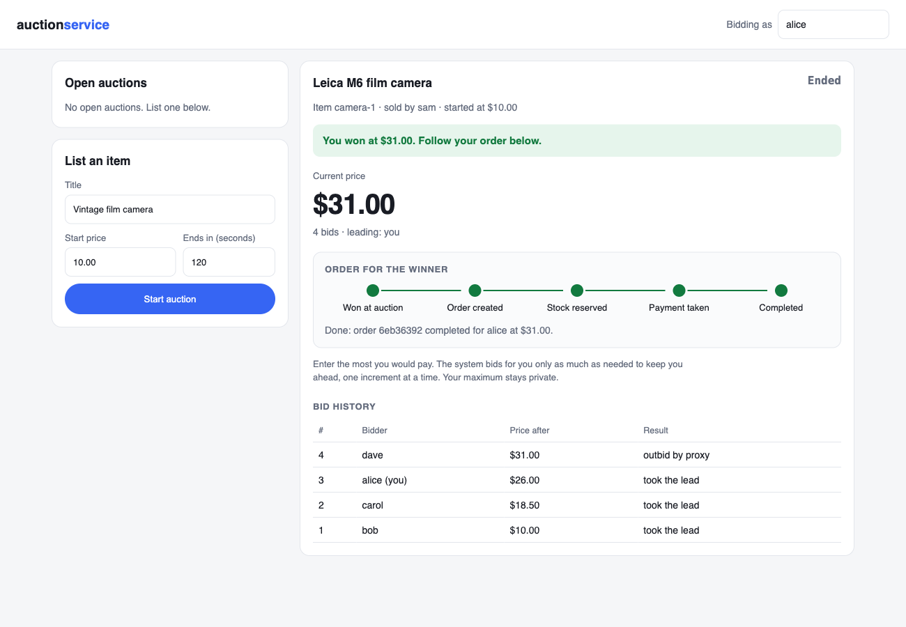

# Distributed Order Processing System

**[Explore the interactive architecture walkthrough](https://akshit9162.github.io/Distributed-Order-System/)** — every stage explained with a diagram, including the animated SAGA state machine, the Kafka fan-out sequence, and the concurrency test's actual verified result.

A microservices-based order processing pipeline implementing the SAGA pattern for distributed transactions, with concurrency-safety guarantees under load. Built to mirror how systems like e-commerce checkout or payment processing work in practice: independent services that must stay consistent without a single database transaction spanning all of them.

## Why this exists

A normal CRUD app reads and writes one database. This system solves a different problem: **inventory**, **payment**, and **order status** are three separate services with three separate databases (true database-per-service). There is no single transaction that can atomically reserve stock, charge the customer, and mark the order complete — because in the real world those are often genuinely separate systems. The core engineering problems this project addresses:

- What happens if payment fails *after* inventory was already reserved? → compensating rollback (the SAGA pattern)
- What happens if a client retries the same request because it timed out? → idempotency keys
- What happens when two orders want the last unit of the same product at the same instant? → distributed locking, proven under real concurrent load in `InventoryConcurrencyTest`

## Architecture

```
           POST /orders
               |
               v
       +----------------+
       |  order-service  |  <-- owns the SAGA state machine
       |   (port 8081)   |      PENDING -> INVENTORY_RESERVED
       +--------+--------+              -> PAYMENT_CONFIRMED
                |                        -> COMPLETED
        publishes OrderCreatedEvent
                |
                v
     Kafka topic: order-created
                |
                v
     +--------------------+
     | inventory-service   |  <-- Redis distributed lock guards
     |    (port 8082)      |      each product during reservation
     +----------+----------+
                |
  reserved? --- Kafka: inventory-reserved --- rejected? --- Kafka: inventory-rejected
                |                                                  |
                v                                                  v
     +-------------------+                                (back to order-service,
     |  payment-service   |  <-- optimistic locking (@Version)     order marked
     |   (port 8083)      |      + retry on conflict               INVENTORY_REJECTED)
     +---------+----------+
               |
confirmed? --- Kafka: payment-confirmed --- rejected? --- Kafka: payment-rejected
               |                                                |
               v                                                v
     order marked COMPLETED                      order-service publishes
                                                   OrderRolledBackEvent
                                                           |
                                                           v
                                            inventory-service releases
                                            the stock it reserved earlier
                                            (the compensating transaction)
```

Each service has its own Postgres database and its own copy of the Kafka event classes (no shared library). This keeps the services independently deployable, at the cost of some duplication — the standard trade-off in microservice architectures.

## Concurrency safety

| Service | Mechanism | Why |
|---|---|---|
| inventory-service | Redis distributed lock (SET NX PX + Lua-script safe unlock, with retry-with-backoff on contention) | Conflicts are common — many orders can compete for one popular product |
| payment-service | JPA optimistic locking (`@Version`) + retry loop | Conflicts are rare — one customer rarely has two payments in flight at once |

## Fault tolerance: dead-letter topics

Every Kafka listener retries a failing message 3 times (1s apart) before publishing the raw record to a `<topic>.DLT` topic instead of blocking the partition or silently dropping it. An operator can inspect `order-created.DLT`, `inventory-reserved.DLT`, etc. and decide whether to replay or discard. Configured in each service's `KafkaConsumerConfig`.

## Caching: Redis cache-aside on `GET /orders/{id}`

`OrderQueryService` checks Redis first, falls back to Postgres on a miss, and populates the cache on the way back (30s TTL). Every status transition in `OrderEventConsumer` explicitly evicts that order's cache entry, so a client polling for status never sees a stale result.

## Load testing

`load-test/order-load-test.js` is a k6 script that hits `POST /orders` with ramping concurrent load (20 → 50 virtual users), asserting p95 < 200ms and p99 < 500ms. Run with `k6 run load-test/order-load-test.js` (setup steps are in the script's header comment). Verified result: `8487 requests, 0 failed, p(95)=136.68ms, p(99)=202.96ms, throughput=169.6 req/s` — all thresholds passed.

## Concurrency stress test

```
docker-compose up -d redis   # only Redis is needed for this test
cd inventory-service
mvn test -Dtest=InventoryConcurrencyTest
```

Fires 50 concurrent reservation attempts at a product with 10 units of stock, asserting exactly 10 succeed and 40 are correctly rejected — proving the lock prevents overselling under real concurrent load. Verified result: `50 concurrent requests for 10 units of stock -> 10 reserved, 40 rejected, in 2801 ms`.

## Auction service: proxy bidding

`auction-service` (port 8084) adds the other way to buy on a marketplace: an auction. When it ends, the winner's
purchase enters the same SAGA as any other order, so inventory and payment work exactly as above.

```
 POST /auctions/{id}/bids ──▶ auction-service ── auction ends ──▶ Kafka: auction-won ──▶ order-service
 (bidder's maximum)           proxy bidding                        (outbox, at least once)  creates the order,
                              optimistic locking                                            key "auction-{id}"
                              SSE live updates                                                 │
                                                                                               ▼
                                                                         inventory reserved → payment → COMPLETED
                                                                         (or compensated, as with any order)
```



**Proxy bidding (second-price).** A bidder enters the most they would pay; the system bids for them only as much
as needed. The leader pays one increment above the second-highest maximum (a standard increment table: $0.05 under $1
up to $100 above $5,000), never more than their own maximum. Ties go to the earlier bid, the leader can raise their
maximum without raising the price, sellers cannot bid on their own items, and maximums are never exposed by the
API. The rules are a pure function (`ProxyBidding`), so they are unit-tested scenario by scenario and can be
replayed exactly.

**Concurrency: optimistic locking with retry.** Every bid reads the auction, applies the rules and writes it back
through a JPA `@Version` check; if another bid committed first, it backs off for a random few milliseconds and
retries on fresh data. Inventory uses a Redis lock because many orders share one product's stock; here each
auction is its own unit of contention, bids are microseconds of work, and nobody holds a lock while a slow
client stalls. `BiddingConcurrencyTest` fires **1,000 bids from 32 threads at one auction**: hundreds of version
conflicts are retried (379 in the last run), every accepted bid is recorded exactly once with gap-free sequence
numbers, and replaying them one by one through the rules reproduces the final price, leader and maximum exactly.

**Ending on time, and handing off safely.** A scheduler closes auctions past their end time through the same
version check, so a bid placed a moment before the deadline is never lost; bids at or after it are rejected.
The SOLD status and an "event not yet published" flag commit together, and the `AuctionWonEvent` is re-sent until
Kafka acknowledges it (a small transactional outbox). Delivery is therefore at least once, and order-service uses
`auction-{id}` as the order's idempotency key, so a redelivered event never creates a second order.

**Live page.** `http://localhost:8084/` lists auctions, starts new ones, and shows one live over Server-Sent
Events: price, leader, countdown, "you've been outbid", bid history. When an auction sells, an **order tracker**
follows the winner's order through the SAGA (order created → stock reserved → payment taken → completed, or the
failure and compensation steps). The page only talks to auction-service, which looks the order up in
order-service by its key (`GET /orders/by-key/auction-{id}`) server to server.

The page is a **React** app (Vite) in `auction-service/frontend`: components for the list, detail, bid form,
countdown, bid history and tracker, with custom hooks for the live auction (`EventSource`), bid history and order
polling. Switching auctions remounts the detail view (`key={id}`), so no state leaks between auctions, and the bid
form only renders once the auction has loaded. `npm run build` writes into `src/main/resources/static`, so the jar
and Docker image serve it with no extra step; `npm run dev` serves it on :5173 against a running auction-service.

**End to end** (`scripts/e2e-auctions.sh`, with `docker compose up -d`): Alice (balance 500) wins one auction and her
order reaches COMPLETED, paying the second price; Bob (balance 10) wins another at 20, payment is rejected and his
reserved stock is released (ROLLED_BACK). Running this for the first time on the full stack found five problems,
all fixed:

| Found | Why | Fix |
|---|---|---|
| Images would not build on Apple Silicon | `eclipse-temurin:17-jre-alpine` has no ARM build | `eclipse-temurin:17-jre` (multi-arch) |
| No service databases existed | `init-multiple-dbs.sh` was not executable, so Postgres skipped it | executable bit recorded in git |
| SAGA stalled for ~5 minutes | consumers started before topics had 3 partitions and only saw 1 until the next metadata refresh | a `kafka-init` container creates every topic with 3 partitions before any service starts |
| Orders stuck in INVENTORY_RESERVED | a fast payment result can arrive before the inventory event (different topics, no cross-topic order) and was dropped as "out of order" | PENDING may go straight to COMPLETED / ROLLING_BACK; the late event is ignored as stale |
| A COMPLETED order reverted to INVENTORY_RESERVED | two listener threads updated the same order at once; the slower write overwrote the faster (no version check) | `@Version` on `Order`; the loser fails and Kafka retries it |

Plus a startup race (Kafka timing out waiting for Zookeeper), fixed with `restart: on-failure`, and a page race where
bidding right after opening an auction, before it had loaded, threw an error (the bid form now renders only after the auction loads).

**Tests.** 30 in auction-service (rules, increments, concurrency, idempotent retries, HTTP outcomes, closing, the
outbox retrying while Kafka is down) and 11 in order-service (auction win → pending order → SAGA, redelivery,
duplicate-key race, lookup by key, out-of-order saga events, concurrent order updates). Run with `mvn test` in each folder; no Docker needed.
10 front-end tests (Vitest + Testing Library: live SSE updates, the outbid notice, bid outcomes, the order tracker, closing
the stream) run with `npm test` in `auction-service/frontend`.

## AWS deployment

The full stack has been deployed and verified end-to-end on a single AWS EC2 instance (Ubuntu, t3.medium) running the same `docker-compose.yml` used locally — Kafka, Postgres, Redis, and all three services as containers on one box. An order was placed and confirmed `COMPLETED` from an external client hitting the instance's public IP.

For a production-style deployment with managed services, Terraform in `/terraform` provisions RDS Postgres, ElastiCache Redis, MSK Serverless (Kafka), ECR repositories, and an ECS Fargate cluster — see `terraform/README.md`.

## Running it locally

```bash
# 1. Start infrastructure
docker-compose up -d

# 2. Build and run each service (separate terminals)
cd order-service && mvn spring-boot:run
cd inventory-service && mvn spring-boot:run
cd payment-service && mvn spring-boot:run
cd auction-service && mvn spring-boot:run    # auctions at http://localhost:8084/

# 3. Seed a product and a customer account
curl -X POST localhost:8082/inventory/seed -H "Content-Type: application/json" \
  -d '{"productId": "sku-123", "quantity": 10}'

curl -X POST localhost:8083/accounts/seed -H "Content-Type: application/json" \
  -d '{"customerId": "cust-1", "balance": 500.00}'

# 4. Place an order
curl -X POST localhost:8081/orders -H "Content-Type: application/json" \
  -d '{
        "idempotencyKey": "demo-key-1",
        "customerId": "cust-1",
        "productId": "sku-123",
        "quantity": 2,
        "amount": 49.99
      }'

# 5. Check the order status - progresses to COMPLETED within a second or two
curl localhost:8081/orders/{id}

# 6. Or win it at auction: list it, bid, and let it end (the winner's order then runs the same SAGA)
curl -X POST localhost:8084/auctions -H "Content-Type: application/json" \
  -d '{"sellerId": "seller-1", "productId": "sku-123", "title": "Camera", "startPrice": 10.00, "durationSeconds": 30}'
curl -X POST localhost:8084/auctions/{auctionId}/bids -H "Content-Type: application/json" \
  -d '{"idempotencyKey": "bid-1", "bidderId": "cust-1", "maxAmount": 40.00}'
```

The auction service alone also runs without Docker: `cd auction-service && mvn spring-boot:run -Dspring-boot.run.profiles=demo`.

## Tech stack

Java 17, Spring Boot 3.3, Spring Kafka, Spring Data JPA, PostgreSQL, Redis, Server-Sent Events, React, Vite, Vitest, JavaScript, Docker + Docker Compose, JUnit 5, GitHub Actions, AWS EC2.

## Contributors

Team project by **Harsh Kokcha** and **Akshit Gupta**. The auction service, the auction → order hand-off and
the shared `OrderCreationService` were added by Akshit Gupta.
